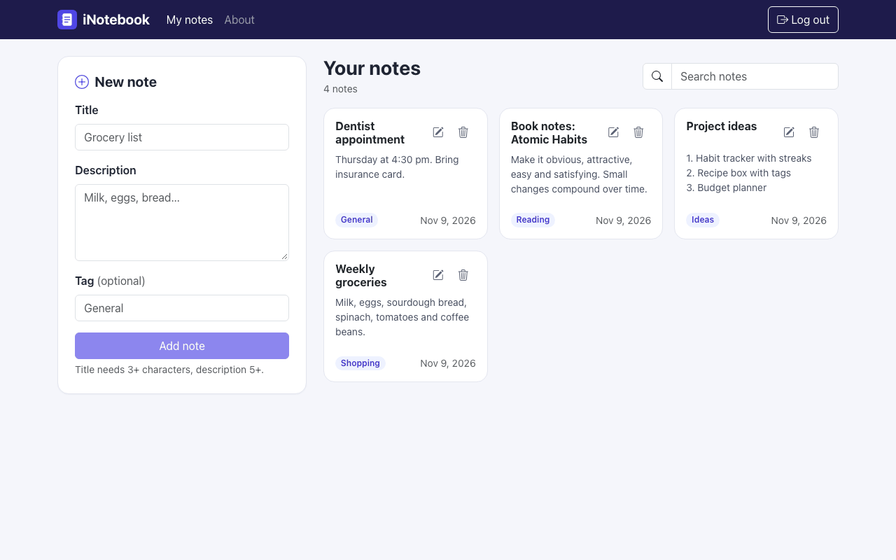
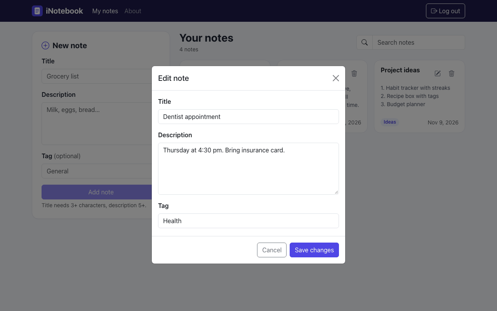
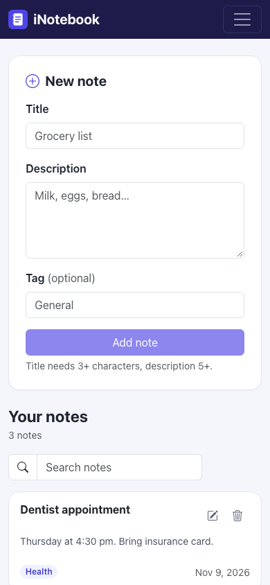

# INotebook

Your notebook on the cloud: a MERN app for creating, editing and deleting personal notes behind JWT login.




| Editing a note | Mobile |
| -------------- | ------ |
|  |  |

## Overview

INotebook is a full-stack note-taking app. A React frontend talks to an Express REST API that stores users and notes in MongoDB. Each user signs up, logs in and can see and manage only their own notes.

## Features

- Sign up (with password confirmation) and log in. Passwords are hashed with bcryptjs, and the API returns a JWT (7-day expiry) that is stored in `localStorage`. Expired tokens send you back to the login page.
- Request validation with `express-validator` on sign-up, login, and when creating or updating notes. Errors are shown inline.
- Add notes with a title, a multi-line description and an optional tag (default `General`); newest notes come first.
- Search notes by title, description or tag.
- Edit notes in a Bootstrap modal and delete them (with confirmation) from the note card.
- Ownership checks on the server: users can update or delete only their own notes.
- Toast alerts for actions, loading/empty/error states, a responsive layout and an About page.

## Tech stack

| Layer    | Technology                                                       |
| -------- | ---------------------------------------------------------------- |
| Frontend | React 18, React Router 6, Context API, Bootstrap 5.3, Bootstrap Icons |
| Backend  | Node.js, Express 4, express-validator, bcryptjs, jsonwebtoken, cors, dotenv |
| Database | MongoDB with Mongoose 6                                          |

## Project structure

```
INotebook/
├── .github/workflows/ci.yml      # install, test and build on every push
├── backend/
│   ├── middleware/fetchuser.js   # verifies the auth-token header
│   ├── models/                   # User, Note
│   ├── routes/                   # auth.js, notes.js
│   ├── config.js                 # environment variables
│   ├── db.js                     # MongoDB connection
│   └── index.js                  # Express entry point
├── public/
└── src/
    ├── api.js                    # API base URL and fetch helper
    ├── components/               # Navbar, Home, Notes, Noteitem, AddNote, Login, Signup, AuthCard, About, Alert
    └── context/notes/            # NoteState (API calls) and noteContext
```

## Getting started

### Prerequisites

- Node.js 18 or later and npm
- MongoDB running locally (default `mongodb://127.0.0.1:27017/inotebookDb`) or a MongoDB Atlas URI

### Install

```bash
git clone https://github.com/VamsiKrishnaThota03/INotebook.git
cd INotebook
npm install
npm --prefix backend install
cp backend/.env.example backend/.env   # then set JWT_SECRET
```

### Run

```bash
# frontend and backend together (from the project root)
npm run both

# or separately
npm run server   # API on http://localhost:5000 (nodemon)
npm start        # React app on http://localhost:3000
```

In development the CRA proxy forwards `/api/*` to `http://localhost:5000`. For a production build, set `REACT_APP_API_URL` to the deployed API origin before `npm run build`.

Other scripts: `npm run build` creates a production build and `npm test` runs the tests.

## Environment variables

Backend (`backend/.env`, see `backend/.env.example`):

| Variable      | Required | Description                                                          |
| ------------- | -------- | -------------------------------------------------------------------- |
| `JWT_SECRET`  | yes      | Long random string used to sign login tokens                         |
| `MONGO_URI`   | no       | MongoDB connection string (default `mongodb://127.0.0.1:27017/inotebookDb`) |
| `PORT`        | no       | API port (default `5000`)                                            |
| `HOST`        | no       | Bind address (default `127.0.0.1`; set `0.0.0.0` on Render or similar hosts) |
| `CORS_ORIGIN` | no       | Comma-separated allowed browser origins (default `http://localhost:3000`) |

Frontend (`.env` in the project root, see `.env.example`):

| Variable            | Required        | Description                                         |
| ------------------- | --------------- | --------------------------------------------------- |
| `REACT_APP_API_URL` | production only | Backend origin, e.g. `https://your-api.example.com` |

## API

Routes marked "Yes" need an `auth-token` header.

| Method | Path                         | Auth | Purpose                                 |
| ------ | ---------------------------- | ---- | --------------------------------------- |
| POST   | `/api/auth/createuser`       | No   | Register a user and return a JWT        |
| POST   | `/api/auth/login`            | No   | Log in and return a JWT                 |
| POST   | `/api/auth/getuser`          | Yes  | Get the logged-in user (without the password) |
| GET    | `/api/notes/fetchnotes`      | Yes  | List the current user's notes, newest first |
| POST   | `/api/notes/createnote`      | Yes  | Create a note (`title`, `description`, `tag`) |
| PUT    | `/api/notes/updatenote/:id`  | Yes  | Update a note you own                   |
| DELETE | `/api/notes/deletenote/:id`  | Yes  | Delete a note you own                   |
| GET    | `/api/health`                | No   | Health check                            |

## Known limitations

- There is no hosted demo. The old GitHub Pages workflow (which published the raw repository, not a working app) was replaced with a CI workflow; the app needs the API and MongoDB running.
- The JWT is stored in `localStorage`, and there is no password reset.
- `npm audit` still reports issues in Create React App's build tooling (`react-scripts` 5) that need a breaking upgrade.
